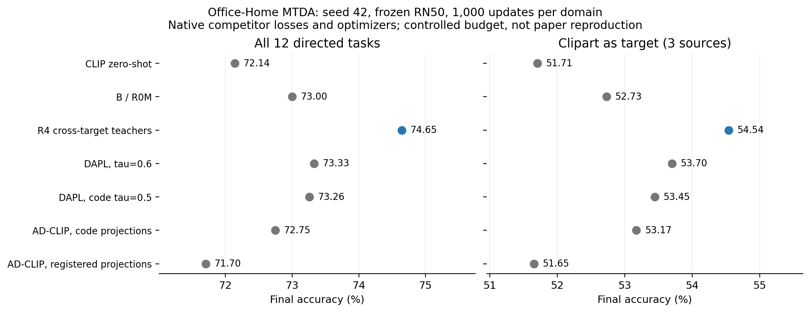

# VLM MTDA controlled comparison

Seed 42, RN50, one source and three simultaneous targets, 1,000 updates and batch 30 per domain. Completed competitor runs: 16/16.

All values below are accuracy percentages. Each source column averages its three targets; Overall averages all 12 directed tasks. Final checkpoints only.

| Method | Art source | Clipart source | Product source | Real World source | Overall | Clipart target |
|---|---:|---:|---:|---:|---:|---:|
| CLIP Zero-shot | 72.26 | 78.95 | 68.73 | 68.61 | 72.14 | 51.71 |
| CLIP Zero-shot (DAPL template) | 72.01 | 78.67 | 68.74 | 68.43 | 71.96 | 51.84 |
| Source Prompt Only | 66.86 | 68.90 | 62.17 | 67.69 | 66.40 | 47.56 |
| B / R0M | 72.56 | 78.90 | 69.19 | 71.35 | 73.00 | 52.73 |
| R2 | 74.14 | 80.94 | 71.02 | 71.91 | 74.50 | 54.61 |
| R4 | 74.51 | 81.25 | 70.87 | 71.96 | 74.65 | 54.54 |
| DAPrompt | 73.24 | 79.90 | 70.32 | 69.86 | 73.33 | 53.70 |
| DAPrompt-CodeTau | 73.22 | 79.89 | 69.86 | 70.06 | 73.26 | 53.45 |
| ADCLIP-Code | 72.90 | 77.74 | 69.74 | 70.62 | 72.75 | 53.17 |
| ADCLIP-Registered | 70.67 | 77.38 | 68.58 | 70.19 | 71.70 | 51.65 |

## All 12 tasks

| Source → Target | CLIP Zero-shot | CLIP Zero-shot (DAPL template) | Source Prompt Only | B / R0M | R2 | R4 | DAPrompt | DAPrompt-CodeTau | ADCLIP-Code | ADCLIP-Registered |
|---|---:|---:|---:|---:|---:|---:|---:|---:|---:|---:|
| Art → Clipart | 51.71 | 51.84 | 48.20 | 52.67 | 54.66 | 54.52 | 53.95 | 53.40 | 52.35 | 51.41 |
| Art → Product | 82.36 | 81.64 | 73.62 | 81.17 | 83.35 | 83.89 | 82.25 | 82.54 | 82.00 | 78.51 |
| Art → Real World | 82.72 | 82.56 | 78.75 | 83.84 | 84.42 | 85.10 | 83.52 | 83.70 | 84.35 | 82.10 |
| Clipart → Art | 71.78 | 71.82 | 61.31 | 72.23 | 74.91 | 74.41 | 74.00 | 73.47 | 71.53 | 69.34 |
| Clipart → Product | 82.36 | 81.64 | 71.80 | 81.71 | 82.74 | 84.12 | 82.23 | 82.70 | 80.60 | 81.30 |
| Clipart → Real World | 82.72 | 82.56 | 73.61 | 82.76 | 85.17 | 85.22 | 83.47 | 83.52 | 81.09 | 81.48 |
| Product → Art | 71.78 | 71.82 | 62.38 | 71.28 | 73.71 | 73.55 | 73.38 | 73.09 | 71.08 | 69.88 |
| Product → Clipart | 51.71 | 51.84 | 44.77 | 51.96 | 54.57 | 53.93 | 53.70 | 53.26 | 54.50 | 52.03 |
| Product → Real World | 82.72 | 82.56 | 79.37 | 84.32 | 84.78 | 85.13 | 83.87 | 83.22 | 83.64 | 83.84 |
| Real World → Art | 71.78 | 71.82 | 69.43 | 74.29 | 74.50 | 74.82 | 73.14 | 73.88 | 72.81 | 72.76 |
| Real World → Clipart | 51.71 | 51.84 | 49.71 | 53.56 | 54.59 | 55.17 | 53.45 | 53.68 | 52.67 | 51.52 |
| Real World → Product | 82.36 | 81.64 | 83.92 | 86.19 | 86.64 | 85.90 | 82.99 | 82.63 | 86.39 | 86.28 |

## Interpretation and limits

The cross-target teacher effect is isolated by R4 minus B/R0M: **+1.6483 pp** at seed 42. Both use the same frozen CLIP, prompt structure, source supervision, per-domain updates and evaluation. Their established three-seed paired gain is +1.7857 ± 0.1571 pp. Competitor ranking supplies a second check at the selected budget; differing native losses, optimizers, parameter sharing and model sizes prevent assigning every ranking difference to teachers.

DAPrompt uses threshold 0.6 from the Office-Home paper; CodeTau uses 0.5 from the released RN50 config. The period in its native zero-shot template is evaluated separately. DAPL accepted-sample CE and shared generic context are preserved.

ADCLIP-Code retains unupdated random first-layer projections from the official Python lists. ADCLIP-Registered explicitly repairs their optimizer registration. Both preserve the official source-input mapping loss and the nonstandard KL/entropy reductions. Target-only inference uses the paper-described mapping substitute because the released RN50 evaluation API does not provide a working single-image path. These are audited code adaptations, **not a reproduction of the paper numbers**.

AD-CLIP sees 30,000 source draws but 90,000 conditional source CE views, because the same source batch participates in three target pairs. Draws include repeated images. Every method receives 30,000 draws and 1,000 updates for each target. Native epoch budgets, random augmentation and AMP are outside this controlled experiment; the user selected the 1,000-step comparison.

Only one competitor seed has been run. Report practical performance under this protocol; do not infer statistical significance or superiority at longer native budgets.

## Artifacts and reproduction

See [protocol](../../docs/vlm_competitors_protocol.md), [12-task CSV](accuracy_12_tasks.csv), [source means](source_summary.csv), [resources and provenance](resources.csv), and [validation](validation.json).

```bash
python scripts/run_vlm_competitors.py --data-root /home/tangxunchi/office_home --clip-checkpoint /home/tangxunchi/.cache/clip/RN50.pt --devices cuda:0 cuda:1
python scripts/evaluate_competitor_zeroshot.py
python scripts/summarize_vlm_competitors.py
```

## Completed comparison and validation

R4 exceeds DAPrompt (paper tau=0.6) by **1.3183 pp**, ADCLIP-Code by **1.8973 pp**, and ADCLIP-Registered by **2.9421 pp**. Each comparison favors R4 in all four source settings. See [findings and next steps](findings.md). All 16 fresh-model restorations reproduce saved tensors exactly and 96 spread-out predictions per target with zero disagreements.


